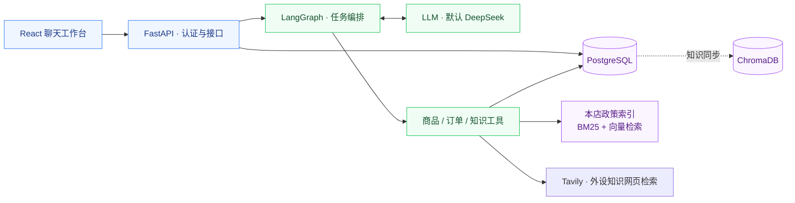

<div align="center">

# PC E-commerce Agent

**面向 PC 外设商城的 AI 客服助手**

从商品选购、规格对比到订单查询与售后咨询，在连续对话中连接用户需求与业务数据。


[功能亮点](#features) · [系统架构](#architecture) · [快速开始](#quick-start) · [配置说明](#configuration)

</div>

---

基于 FastAPI、LangGraph 和 React 构建的全栈客服 Agent。后端将用户请求拆解为任务，通过商品、订单与知识检索工具获取依据，再生成回答；前端提供登录、历史对话、商品展示和人工请求交互。

项目源自硕士毕业设计团队项目，目前用于持续开发与本地演示。团队来源见[致谢](#acknowledgements)。

<a id="features"></a>
## 功能亮点

| 能力 | 可以做什么 | 对话示例 |
| --- | --- | --- |
| **商品选购** | 按预算、类别和规格检索商品，比较候选商品 | “推荐一款 500 元以内的机械键盘” |
| **连续对话** | 承接本轮上下文，管理用户明确表达的长期偏好 | “有没有更便宜的？” |
| **订单查询** | 查询当前登录用户的订单与物流信息 | “查看我的最近一笔订单” |
| **知识问答** | 结合本店政策资料与外设知识网页检索结果回答问题 | “退货需要满足什么条件？” |
| **人工请求** | 记录需要人工确认的售后诉求，查询请求状态 | 在页面提交退货或维修诉求 |
| **用户隔离** | 登录认证，并校验会话、记忆与订单的归属 | 不同用户访问各自的业务数据 |

> [!NOTE]
> 当前支持查询、咨询和人工请求记录。退款、订单修改、支付及真实客服派单尚未接入；提交人工请求不会自动办理这些业务。

<a id="architecture"></a>
## 系统架构



| 层级 | 技术与职责 |
| --- | --- |
| 前端 | React 19 · TypeScript · Vite，提供聊天与业务信息展示 |
| API 与编排 | Python 3.11 · FastAPI · LangGraph，负责认证、任务执行和回答生成 |
| 数据存储 | PostgreSQL · SQLAlchemy · Alembic，保存业务数据、会话与运行记录 |
| 知识检索 | 本店政策：本地 JSON · BM25 + SentenceTransformer；外设知识：Tavily Web Search |
| 本地基础设施 | Podman 管理 PostgreSQL、Redis 和 ChromaDB |
| 依赖管理 | uv 与 npm，分别通过锁文件安装后端和前端依赖 |

政策工具使用本地索引，外设知识工具使用 Tavily；ChromaDB 保留知识同步路径，Redis 当前用于健康检查。页面通过 `/api/chat` 一次性获取完整回答及执行详情。

<a id="quick-start"></a>
## 快速开始

以下步骤适用于 **macOS / Linux 本地开发**。获取代码后进入项目根目录，所有 `make` 命令均在该目录执行。

### 1. 准备环境

| 工具 | 要求 |
| --- | --- |
| [uv](https://docs.astral.sh/uv/getting-started/installation/) | 安装 Python 3.11 与后端依赖，无需额外创建 Conda 环境 |
| [Node.js](https://nodejs.org/en/download) / npm | 推荐 Node 24，最低 Node 22；版本约定位于 `.nvmrc` |
| [Podman](https://podman.io/docs/installation) | macOS 需先启动 Podman machine |
| Make / curl | 执行项目命令与服务就绪检查 |

<details>
<summary>macOS 工具准备与 Podman machine 检查</summary>

已安装 Homebrew 时，可用 `brew install uv` 安装 uv。使用 nvm 时，在项目根目录执行 `nvm install` 和 `nvm use`，选择 `.nvmrc` 中的版本。

```bash
podman machine list
```

仅在没有 machine 时执行 `podman machine init`；已有 machine 未运行时执行 `podman machine start`。

</details>

```bash
make doctor
```

检查工具和 Podman 连接。首次安装需要联网下载依赖、容器镜像，以及缺失的 Python 或 embedding 模型。

### 2. 配置环境变量

根目录尚无 `.env` 时，复制模板：

```bash
cp .env.example .env
```

编辑 `.env`，核对以下配置：

| 配置 | 填写方式 |
| --- | --- |
| `LLM_API_KEY` | 填入自己的模型 API key，默认使用 DeepSeek |
| `TAVILY_API_KEY` | 外设知识网页搜索：在 [Tavily](https://app.tavily.com) 注册后填入 key；留空时明确返回未配置，本店政策检索不受影响 |
| `AUTH_TOKEN_SECRET` | 填入私有随机字符串，用于后端签发和验证登录凭证 |

生成认证密钥：

```bash
openssl rand -hex 32
```

将输出复制到 `AUTH_TOKEN_SECRET`，保留在本机。已有 `.env` 时直接核对配置，不要重新覆盖。前端默认通过 `/api` 代理访问后端，无需另配环境文件。

Tavily 使用 basic 搜索，每次请求最多 10 条，8 秒总超时，不自动重试或请求生成式答案。官方目前提供每月 1,000 免费 credits，无需绑卡，basic 每次 1 credit；以 [官方额度说明](https://docs.tavily.com/documentation/api-credits) 为准。填好 key 后重启后端。key 仅放根目录 `.env`，不要放入 `VITE_*`。

本店政策默认使用 BM25 + 本地向量混合检索，索引缺失或过期时退回 BM25 并标明实际策略。请求内不下载模型；缺少模型时运行已有的 `make model-prepare` 显式准备。政策超时为 8 秒；同步计算移到单个后台线程，超时或取消后运行中的计算仍占用名额直到完成，期间新请求返回忙碌状态。

商品三工具采用分阶段规划：先识别范围，指定商品查询先定位身份，再按适用规则规划条件和事实；目录统计不强制指定品类。范围识别、详细规划与语义复核共用 60 秒预算、最多两次纠错和一次传输重试，正常三次模型调用；身份待确认时提前返回，明确编号的简单查询保留直接路径。订单仍采用规划加复核，正常两次模型调用。复核使用成对示例及程序派生的条件匹配解释。外层工具超时均为 75 秒。无法确认或耗尽预算返回失败，不作为“没有商品/订单”。明确编号等确定性路径仍按原规则执行。离线检查和真实模型对照入口见 [评测说明](evals/README.md)。

> [!IMPORTANT]
> 真实 `.env`、API key 和数据库备份不提交到 Git。模型 key 留空时只有有限 fallback，无法验证完整 AI 对话能力。

### 3. 初始化数据与依赖

**首次创建本地演示环境：**

```bash
make setup-local
```

依次完成工具检查、前后端依赖安装、配置校验、基础设施启动、数据库迁移、演示数据导入、Chroma 同步和本地检索模型准备。初始化完成后，继续下一步启动前后端。

| 演示内容 | 默认规模 |
| --- | --- |
| 商品 | 6 类外设 · 192 个 SPU · 2,304 个 SKU |
| 用户与订单 | 6 个演示用户 · 26 笔订单 |
| 知识检索 | 仓库内置知识 JSON 与向量索引 |

这些是脚本生成或仓库内置的演示数据；拉取代码不会带上其他开发者数据库中的聊天记录和业务变更。

> [!WARNING]
> `make setup-local` 会向配置指向的数据库写入数据。**已有本地数据库时，使用下面的复用流程**，不必重复初始化。

<details>
<summary><strong>复用已有数据库：安装依赖并检查现有环境</strong></summary>

```bash
make install
make config-check
make infra-up
make db-status
make model-prepare
```

`db-status` 显示已应用迁移与可用 head；版本一致且已有演示数据时，可直接启动。版本落后时按需执行 `make db-migrate`。

默认 `PODMAN_PROJECT_NAME=pc-agent`，会复用同名容器和数据卷。仅移动或重命名代码目录不会隔离数据库。需要独立环境时，见[配置说明](#configuration)。

</details>

### 4. 启动并体验

打开两个终端，均进入项目根目录：

**终端 A · 后端**

```bash
make backend
```

**终端 B · 前端**

```bash
make frontend
```

| 入口 | 地址 |
| --- | --- |
| **应用页面** | [localhost:5173](http://localhost:5173) |
| API 文档 | [127.0.0.1:8000/docs](http://127.0.0.1:8000/docs) |
| 服务健康检查 | [127.0.0.1:8000/api/health](http://127.0.0.1:8000/api/health) |

使用已初始化的演示账号登录：

| 账号 | 密码 |
| --- | --- |
| `demo@example.com` | `demo-password` |
| `test_user_001@example.com` ～ `test_user_005@example.com` | `isolation-demo-password` |

检查健康接口中的 `postgres`、`redis`、`chroma` 均为 `ok`，再依次体验登录、商品推荐、追问、本人订单查询和政策问答。

## 日常开发

完成首次安装后，每次启动只需：

```bash
make infra-up     # 启动基础设施
make backend      # 终端 A：后端
```

```bash
make frontend     # 终端 B：前端
```

前后端分别按 **Ctrl+C** 停止；`make infra-stop` 停止基础设施，保留容器与数据卷。

<details>
<summary>常用命令速查</summary>

| 命令 | 用途 | 数据影响 |
| --- | --- | --- |
| `make help` / `make doctor` / `make infra-status` | 帮助、环境检查与容器状态 | 只读 |
| `make install` | 安装锁定的前后端依赖 | 不写数据库 |
| `make config-check` | 检查配置结构与认证密钥占位值 | 不验证凭据真伪或连通性 |
| `make db-status` | 查看数据库迁移版本 | 只读 |
| `make db-migrate` | 应用新增迁移 | 修改数据库结构 |
| `make db-init` | 迁移、商品导入、演示数据与知识同步 | 写入数据 |
| `make model-prepare` | 下载或预热模型，校验本地索引 | 不重建业务数据 |
| `make knowledge-index` | 重建本地知识向量索引 | 修改本地索引文件 |
| `make knowledge-sync` | 将 PostgreSQL 知识表同步到 Chroma | 写入 Chroma |
| `make check` | 后端测试与 Lint、前端构建 | 当前不含真实数据库测试；默认排除外部网络用例 |

查看日志：`./scripts/podman-infra.sh logs postgres`，服务名也可替换为 `redis` 或 `chroma`。

`down` 移除容器但保留卷；`reset` 删除容器及数据卷，需要显式设置 `CONFIRM_RESET=1`。两者均不属于日常启动步骤。

</details>

<a id="local-phoenix-trace"></a>
## 本地 Phoenix 核心 Trace（P4 首期）

平台与模拟API核验已完成；2026-10-22用户确认Phoenix页面验收通过，P4首期完成。当前追踪粒度作为稳定版本，后续按需增加；这不代表工具业务问题或P3/P3A质量、成本门槛已通过。
可查看合成trace `6b109bdb778d7483bf1930a0bca0d9f7`（两次失败后补查成功）。

新 loop 已接入核心追踪，Phoenix `20.23.0` 独立运行在 Podman；默认关闭追踪、默认 runtime 为 strands（新 loop）。
本轮先实施核心追踪以支持 P3/P3A 排错，不放宽既有质量或成本门槛。

```bash
make trace-up       # 创建/启动独立平台；首次需要下载官方锁定镜像
make trace-status   # 检查容器与实际端口绑定
make trace-stop     # 停止，保留容器和数据卷
```

浏览器打开 **http://127.0.0.1:6006**，项目为 **pc-ecommerce-agent-local**。
网页及 OTLP HTTP 共用本机 6006 端口，不发布 gRPC 端口，不上传云端。
脚本不读取 `.env`，遇到名称、镜像或端口归属冲突会拒绝操作，不覆盖既有资源。

后端开启方式（需要重新启动后端进程）：

```bash
LOOP_TRACE_ENABLED=true make backend RUNTIME=strands
```

也可自行在根 `.env` 设置 `LOOP_TRACE_ENABLED=true`；本轮没有改写现有 `.env`。
关闭时设为 `false` 并重启。旧 `AGENT_TRACE_MODE` / LangSmith 行为保留，与新开关独立。
后端日志打印 `Local Phoenix trace_id=...`；页面按请求时间定位“用户请求”，核对 trace ID，
也可通过 `session.id` / `run_id` 对照会话和运行记录。失败、取消也保留根记录。

| 内容 | 首期查看位置 |
| --- | --- |
| 用户输入、最终答案、runtime、模型、Git HEAD、dirty、会话/run、停止原因 | “用户请求”的输入输出和属性；时间及总耗时由 span 提供 |
| 每次实际模型请求，包括查询、工具规划/复核、独立回答及修正/传输重试 | 相应 LLM span 的 Input / Output Messages；按角色/文本块/工具调用显示原始消息，调用参数在 Invocation Parameters，工具定义在 llm.tools；标题含用途、请求序号及返回动作类别 |
| 每次工具尝试及失败 | `catalog_search` 等 TOOL span；实际规范化参数、原始结果、goal/operation/attempt/invocation/evidence/SDK调用标识；工具内部模型为子 span |
| 校验拒绝 | 所属请求/工具的 `validation.rejected` 事件：原始提交、错误、反馈、关联 model_span_id |
| 回答材料 | “模型 · 回答生成” Input Messages 中第二条 message（完整 AnswerInput，除脱敏/明确截断）；无实际回答请求而降级时补记 answer_materials |
| Token | 实际返回的 prompt/completion 用量；缺失为 usage_status=unknown，不记零，不生成金额 |

模型标题示例：`模型 · 任务规划与调度 #1 → 目标登记提案、业务工具请求`、`模型 · 任务规划与调度 #8 → 查询结束申请`、`模型 · 回答生成 #9 → 回答候选`。序号是本轮实际模型请求的全局顺序（含工具内部请求），不是查询轮次。类别由实际工具调用名及阶段确定，支持同次多个动作；提案/候选不表示校验通过或业务成功，仍需查看拒绝事件和实际工具结果。结构化业务材料本身仍保留 JSON；旧 trace 不会自动变成新格式。

精简查看：新记录在节点的 **Info → Metadata** 卡片中显示少量关键字段。可先收起 Input / Output，只展开 Metadata；它不是自动替换 Messages 的默认视图。模型摘要包含用途、请求序号、关键输入、提交动作和输出概况；商品工具摘要包含关键参数、结果数量/状态、排序窗口、最近一次校验拒绝和复核结论；材料摘要仅表示最近一次投影，全部事件仍在 Events。回答节点只摘要目标/证据数量、投影缺口和带省略标记的答案预览。摘要最多4096字符，超限明确标记；与完整消息/结果共存，不减少原采集字段。完整span导出保留两者（仍受原脱敏/截断规则限制）；当前卡片复制只复制该卡片。旧记录不会自动补摘要。

工具层排错：树中 `模型 · 工具查询规划` 是生成查询计划，`模型 · 工具计划复核` 是检查计划对用户要求的忠实程度（不是复核数据库结果）；`工具 · catalog_search` 是实际工具执行。工具下另列 `程序 · 计划校验`、`程序 · 复核输出校验`、`程序 · 工具输出校验` 三类独立节点，标题标明【通过】或【拒绝】，重复尝试分别展示；模型相关校验关联来源模型，拒绝显示错误。复核输出校验通过只表示结论结构和执行所需反馈合法，不检查原文摘录或路径，也不证明语义正确；模型的批准/修正结论另见 `model_verdict`。“程序 · 工具输出校验”的Input保存校验前工具返回值，Output仍保存校验结论；Input沿用脱敏和截断规则，无法序列化时明确标记缺失，不影响原校验。三类节点的check_scope分别说明计划执行合法性、复核输出结构和结果契约一致性；复核节点schema为ToolPlanReview，plan_schema单独标明被复核计划类型。数量窗口摘要区分requested_count、limit、limit_capped和returned_count；身份尚待确认时，条件筛选事件标记skipped_identity_pending。其他程序判断保留为事件。进入工具的 **Events** 查看 `程序 · …` 事件：上下文范围、计划校验/变更字段、计划复核结论、再次调用原因、执行计划、对象定位、条件筛选计数、排序窗口及返回摘要。事件的 `outcome` 表示处理结论，`details` 保存有限结构化信息；模型相关事件带 `model_span_id`。只复用已有判断和计数，不额外查询或调用模型，不记录逐商品判定/SQL/全量数据库行。

`程序 · 材料投影` 在工具节点（交给调度模型）或请求根节点（交给回答模型）的 Events 中，按 evidence/invocation/operation ID 关联；记录投影前后字符数、限制、移除字段和保留商品数量，不复制完整材料。`destination=query|answer` 区分接收阶段。这是业务投影记录，和追踪自身的 `trace.input.truncated` 不同。

脱敏覆盖凭据字段、当前配置中的明确密钥、认证文本、连接凭据、邮箱/手机号及常见个人信息字段；
不采集 HTTP 头、Settings、客户端或连接对象。自由文本脱敏为规则处理，不是语义级个人信息识别。
通用输入/输出/事件快照上限 32768 字符，超限显示原始长度和“已截断”。模型消息每个方向共用 32768 字符及 180 个内容属性上限（含该方向附属参数），超限以 `trace.input.truncated` / `trace.output.truncated` 和提示明确标记；不重复保存完整模型报文。深层内容也明确标记。
不保存附件，不宣称截断内容完整。快照即时序列化，后续对象修改不影响记录。

不记录普通内部函数、SQL、数据库全量行、每步 Agent 状态、逐 Token 事件或未返回的内部思考；
不做自动评分、Prompt 管理、回放、独立指标或自建追踪页面。停止说明仍仅作审计，不改回答输入。
未使用 `llm.model_name` 自动估价字段；模型名称在 `model` 属性和实际请求中查看。

平台离线或导出失败不重跑模型/工具、不改变预算和业务结果。后台队列最多 256 span，每批最多16条，
发送超时1秒，500ms触发批次；退出最多等待2秒。失败、队列满或退出超时会提示记录可能丢失。
恢复平台后新请求可继续导出；已经丢失的记录不会自动补传。

### 隔离模拟演示及页面检查

```bash
make trace-demo
```

这是显式入口：正式新 runtime + MockTransport 模型 + 内存 repository + 合成商品；
保留离线保护，只在本进程允许 `127.0.0.1:6006`，不接触真实 LLM 或商城数据库，不在默认测试收集内。
预热后比较开/关追踪的一组相同输入，只导出开启组的一条 trace。报告位于 `artifacts/tests/phoenix-demo/report.json`。
演示包含一次参数拒绝、两次工具失败、一次补查成功，以及使用299元成功结果的最终回答。
演示还通过平台只读 API 确认记录入库；API 验证不等于页面验收。

页面检查顺序：进入项目 → 找到日志 trace ID 对应的“用户请求” → 依次展开三个 `catalog_search` →
对照各自 input/output 和错误状态 → 展开工具规划模型子节点 → 查看“独立回答”的 input 与 output。
如果模型提交错参数，看前一条查询模型输出和根记录的拒绝事件；如果参数正确但工具失败，看 TOOL 的错误和内部模型；
如果工具已成功而回答遗漏，看回答输入是否包含该 evidence，再对照原始回答与最终答案。
查看超限标记，不能把缺少的内容当成没有发生。

### 环境、持久化与清理

- 平台镜像：`docker.io/arizephoenix/phoenix:version-20.23.0`；容器：`pc-ecommerce-agent-phoenix`。
- 数据：Podman 专用卷 `pc-ecommerce-agent-phoenix-data`，容器内 `/data/phoenix.db`（SQLite）；与商城数据库/卷无关。
- 后端：`backend/.venv`；uv新增 `opentelemetry-exporter-otlp-proto-http==1.45.0`，另带最少HTTP transport依赖，复用已有 OTel；不安装 Phoenix 服务。
- 前端：沿用 `frontend/node_modules`，无前端改动。
- 停止及移除容器不会删除专用卷；需重建时先停止，仅移除上述 Phoenix 容器，再 `make trace-up`，会复用原卷。
- 清理全部记录是单独的破坏性操作：确认不再需要后，先停止并移除上述 Phoenix 容器，才手动删除上述专用卷；stop/up均不执行清理。

本机若无法直接拉取，可从官方仓库取得匹配架构的 OCI 归档，`podman load -i <归档>` 后核对版本与镜像ID，
再删除临时归档。此机器本轮通过已有系统代理完成 ARM64 镜像下载，校验后导入；临时下载目录已删除，未改网络设置。

接入核对依据：[Strands 官方追踪](https://strandsagents.com/docs/user-guide/sdk/observability-evaluation/traces/)、
[Phoenix 官方部署](https://arize.com/docs/phoenix/self-hosting/deploying-phoenix)。锁定 Strands 为1.61.1；
其原生逻辑调用span不能逐一表示本项目适配器内的传输重试，且用量可能归零，独立 TextModel 也不在该边界内。
因此首期复用已有模型客户端请求边界统一记录实际请求，使用私有 OTel provider，不叠加 SDK/OpenAI/HTTP 自动采集。

<a id="configuration"></a>
## 配置说明

后端与 Podman 脚本读取根目录 [`.env.example`](.env.example) 对应的 `.env`；前端可选配置见 [`frontend/.env.example`](frontend/.env.example)。后端按源码位置定位配置，不依赖终端所在目录。

<details>
<summary>模型、数据库与基础设施配置</summary>

| 配置 | 说明 |
| --- | --- |
| `LLM_PROVIDER` / `LLM_MODEL` / `LLM_BASE_URL` | 默认 DeepSeek；base URL 留空时按 provider 选择 |
| `AGENT_RUNTIME` | `strands`（默认，两阶段查询／独立回答）或 `legacy`（显式切回旧链路）；重启后生效，一次请求只运行所选链路。默认切换按用户授权执行，不代表既有质量／成本及端到端验收已通过 |
| `POSTGRES_DB` / `POSTGRES_USER` / `POSTGRES_PASSWORD` | 创建 PostgreSQL 容器时使用的数据库凭据 |
| `DATABASE_URL` | 后端数据库连接，须与用户、密码及主机端口一致 |
| `REDIS_URL` / `CHROMA_HOST` / `CHROMA_PORT` | 后端连接 Redis 与 Chroma 的地址 |
| `PODMAN_PROJECT_NAME` | 容器和数据卷命名前缀，默认 `pc-agent` |
| `POSTGRES_PORT` / `REDIS_PORT` / `CHROMA_PORT` | 默认主机端口：5432 / 6379 / 8001 |
| `POSTGRES_IMAGE` / `REDIS_IMAGE` / `CHROMA_IMAGE` | 镜像选择；Chroma 在模板中固定为不可变摘要 |
| `BACKEND_CORS_ORIGINS` | 默认允许 localhost / 127.0.0.1 的 5173 端口 |

Podman 设置优先使用非空 shell 环境变量，未设置时读取 `.env` 或默认值。环境文件使用简单 `KEY=value` 或整段引号值，不使用 shell 表达式、变量插值或行尾注释；数据库 URL 中的特殊字符需 URL 编码。

</details>

<details>
<summary>前端代理与自定义端口</summary>

前端需要覆盖默认配置时，复制 `frontend/.env.example` 为 `frontend/.env.local`：

- `VITE_DEV_PROXY_TARGET`：开发代理目标，默认 `http://127.0.0.1:8000`。
- `VITE_API_BASE_URL`：浏览器直连 API 的地址；默认留空，使用代理。

例如将后端改为 8002 端口：

```bash
make backend BACKEND_PORT=8002
```

同时将前端 `VITE_DEV_PROXY_TARGET` 改为 `http://127.0.0.1:8002` 并重启前端。`BACKEND_HOST` 和 `BACKEND_PORT` 是 Make 参数，不从根目录 `.env` 读取。

前端固定使用 5173，端口被占用时会报错，不自动换端口。修改前端端口时同步调整 Vite 配置和 CORS。前端不读取根目录 `.env`，`VITE_*` 中不放服务端密钥。

</details>

<details>
<summary>创建独立数据库，避免与其他本地副本共享数据</summary>

初始化前修改 `PODMAN_PROJECT_NAME`，并选择未占用的主机端口，例如 PostgreSQL 15432、Redis 16379、Chroma 18001；同步调整 `DATABASE_URL`、`REDIS_URL` 和 `CHROMA_PORT`。

只更换前缀不能解决端口冲突。已有容器不会自动重建，修改 `.env` 也不会修改已有数据库用户的密码。端口不一致时脚本会停止并提示。

</details>

## 项目结构

```text
.
├── backend/
│   ├── app/
│   │   ├── agent/          # LangGraph 编排、任务与上下文
│   │   ├── api/            # FastAPI 路由
│   │   ├── tools/          # 业务工具契约与实现
│   │   ├── services/       # 认证、记忆与知识服务
│   │   ├── repositories/   # 数据访问
│   │   └── models/         # 数据模型
│   ├── alembic/            # 数据库迁移
│   ├── data/               # 运行所需的知识与向量索引
│   ├── scripts/            # 环境、导入、seed 与知识维护
│   └── uv.lock             # 后端依赖锁文件
├── frontend/
│   ├── src/                # 页面、组件与 API 封装
│   └── package-lock.json   # 前端依赖锁文件
├── tests/                  # 当前隔离测试、显式 legacy 与 integration
├── evals/                  # 模型效果评测驱动、用例和评分
├── artifacts/              # 本地生成的评测结果和 Trace（忽略）
├── scripts/                # 环境检查与 Podman 管理
├── .env.example            # 后端与基础设施配置模板
└── Makefile                # 安装、启动与检查的统一入口
```

## 测试与维护

目录整理后有效测试统一在根 [tests](tests/README.md)，模型效果评测在 [evals](evals/README.md)。

```bash
make agent-loop-test       # 当前 loop 的 business / smoke / contracts
make tools-test            # 工具隔离测试
make application-test      # API / 鉴权 / 记忆 / 基础设施隔离测试
make legacy-test           # 显式旧 Graph 隔离检查，不进入默认集合
make check                 # 当前隔离测试、Ruff、前端构建
```

这些检查使用已有依赖和网络阻断保护，不调用真实模型、不连接真实数据库；不自动安装依赖。
默认不收集 legacy、integration 或模型评测。`make integration-test` 会写入明确隔离的真实数据库；
`make model-eval` 调用真实 LLM、消耗额度，二者均仅显式执行，本轮未运行。
检查通过不代表真实模型效果、数据库持久化或浏览器验收通过。

编排按启动进程配置切换：

```bash
make backend RUNTIME=strands
make backend RUNTIME=legacy
make backend                 # 保留环境变量 → .env → 代码默认 strands 的优先级
```

`RUNTIME` 只接受 `strands` / `legacy`，不改 `.env`；保留 `BACKEND_HOST` / `BACKEND_PORT`。
API 经 `agent/factory.py` 延迟导入选中的 runtime，一次请求只执行一套。
`agent/loop` 是固定外层 → Strands 查询 → 程序交接 → 独立回答；`agent/legacy` 保留旧 Graph，
两者使用当前共用工具。legacy 并非完整冻结基线，后续工具优化也影响它。
历史恢复以 Git 为主，历史档案包及范围见 [历史档案与恢复](#history-archive)。

旧链路现有本地追踪默认关闭，显式开启时仍使用原有 `artifacts/traces/` 行为。
新loop通过本地Phoenix保存完整trace，启动和存储见[追踪说明](#local-phoenix-trace)；
P4首期已验收，[AL-016已关闭](docs/development/issues.md#al-016)。默认runtime已按用户授权切为strands，legacy可显式切回。
P3 10/11、P3A 11/12仍未放行；P5清理须满足原质量/成本条件，不因追踪验收自动开始。

- **依赖更新**：后端修改 `pyproject.toml` 后在 `backend/` 执行 `uv lock`；前端通过 npm 更新并提交锁文件。普通安装保持锁定版本。
- **知识更新**：修改 `backend/data/knowledge_documents.json` 后执行 `make knowledge-index` 并重启后端；`make knowledge-sync` 不会更新本地 JSON 索引。
- **评测输入**：仓库不包含根目录客服 CSV 评测数据集，对应评测需自行提供输入，不影响应用启动。

代码约定见 [AGENTS.md](AGENTS.md)。

<a id="history-archive"></a>
### 历史档案与恢复

2026-10-21，原 `archive/` 和 `local-backups/` 已封存到本地
`pc-ecommerce-agent-history-20261021.zip`，原目录删除。ZIP 被 Git 忽略，供手动移到项目外保管；
普通启动和验证不依赖它，也不保证其他检出环境拥有此包。
包内有完整迁移清单、历史成功/失败证据、退役脚本、旧说明和原有备份，以及 `RESTORE.md`、
逐文件 SHA256 清单 `MANIFEST.json`。70 个原文件已逐一校验；本包不是当前未提交工作区的完整快照。

整理前基点为 `refactor/agent-loop` 的 `06c84eb3463c5d32f068bb37ef1465b2c5a575cc`。
需要恢复时在独立目录检出该提交，再按包内 `local-backups/pre-layout-20261020/RESTORE.md`
使用内层源码 ZIP；不要覆盖当前工作区。完整历史比较依赖原 Git 版本，可运行 legacy 使用当前共用工具。

补充档案 `pc-ecommerce-agent-history-supplement-20261021.zip` 收录此前遗漏的
`docs/archive/`、商品评测旧辅助脚本、生成示例、退役输入及原 README，共 22 个原文件。
逐文件 SHA256 与 ZIP 完整性校验通过后移除原历史目录；包内附 `MANIFEST.json` 和 `RESTORE.md`。
此补充包被 Git 忽略，待手动移到项目外，与主档案包分别保管；不是完整源码备份。
有效商品输入保留，旧编排专项迁到 `evals/legacy/`，当前对照入口仍在 `evals/agent/`。

当前目录迁移要点：`agent/runtime.py` → `agent/loop/runtime.py`，原 `agent/graph.py` →
`agent/legacy/runtime.py`，原 `agent/workflow.py` → `agent/legacy/graph.py`；API 统一通过 factory 选择。
原 `backend/tests` 已按职责归入根 tests，评测脚本及输入归入根 evals，生成结果归入 artifacts。
所有原测试函数保留；删除的是被统一入口替代的 pytest 配置和旧目录空包标记，没有旧路径转发入口。
历史整理验证为默认 1396 项、显式 legacy 833 项通过，含 9 项新增入口/隔离检查；
这些是 2026-10-20 整理任务的记录，本次打包没有重跑测试或真实服务验证，也不改变 P3/P3A 放行状态。

## 常见问题

<details>
<summary>系统 Python 版本不对，或提示找不到 uv</summary>

先安装 uv 并重新打开终端，再运行 `make doctor` 和 `make backend-install`。uv 按项目约定选择 Python 3.11，后端启动自动使用 `backend/.venv`。

</details>

<details>
<summary>Podman 无法连接，或容器启动失败</summary>

macOS 先检查 `podman machine list`，启动已有 machine。使用 `make infra-status` 查看容器，使用 `./scripts/podman-infra.sh logs chroma` 等命令查看日志，再核对端口、镜像与数据卷兼容性。

</details>

<details>
<summary>配置检查提示 AUTH_TOKEN_SECRET 无效</summary>

执行 `openssl rand -hex 32`，将结果填入本地 `.env`，替换占位值。它是后端的登录凭证签名密钥，不是用户密码或模型 API key。

</details>

<details>
<summary>页面能打开，但请求失败或 AI 回答不完整</summary>

先检查后端终端日志和 `/api/health`，确认后端正在运行、代理指向正确地址；直连模式还需核对 CORS。完整 AI 对话需要有效模型 key。首次知识问答慢或下载失败时，运行 `make model-prepare` 检查模型准备情况。

</details>

<details>
<summary>依赖锁文件不一致，安装失败</summary>

核对依赖声明与锁文件是否配套；维护者更新声明后应重新生成锁文件并验证。不要通过删除锁文件绕过检查。

</details>

<a id="acknowledgements"></a>
## 致谢

本项目基于硕士毕业设计团队共同开发的 [Loda951/pc-agnet](https://github.com/Loda951/pc-agnet) 持续维护，保留原团队贡献与项目来源。当前版本在此基础上完善运行环境与依赖管理，并继续完善功能和设计。
