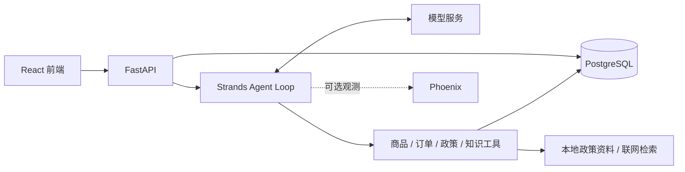

# PC E-commerce Agent

**面向 PC 外设商城的 AI 客服助手，让选购咨询围绕需求与商品事实展开。**

外设选购既有领域知识门槛，又以参数比较为主：键盘的轴体与连接方式、鼠标的重量与 DPI、
显示器的分辨率与刷新率，都需要结合预算和使用场景判断。用户往往从“想买个适合办公的键盘”
开始，在对话中逐步明确条件，而价格、库存、订单和店铺政策又需要查询实际数据。

这让外设电商很适合用 Agent：理解自然语言需求，通过追问与连续对话明确条件，调用工具检索、
筛选商品，再用用户能理解的方式解释选择依据。本项目提供可在本地运行的前后端和 Demo 数据，
用于体验这一完整流程。

[快速开始](#quick-start) · [演示体验](#demo-data) · [Phoenix 观测](#local-phoenix-trace) · [分支说明](#branches)

## 功能

- **商品选购**：按预算和规格筛选商品，查询型号与版本详情，辅助比较候选。
- **连续咨询**：承接上下文和用户偏好，逐步缩小选购范围。
- **订单与物流**：查询当前登录用户的订单、商品明细和物流进展。
- **政策与知识**：引用店铺政策，检索外设知识，解释参数与使用问题。
- **人工诉求**：记录需要人工处理的请求；不自动办理支付、退款或订单修改。

<a id="architecture"></a>
## 架构概览



<a id="quick-start"></a>
## 快速开始

以下步骤适用于 **macOS / Linux 的首次本地搭建**。准备 uv、Node.js 24（最低 22）、npm、
Podman、Git、Make、curl 和 OpenSSL。Python 3.11 由 uv 管理。安装需联网下载依赖、镜像与模型；
AI 对话需自备模型 API Key，模型与搜索调用可能产生费用。

### 1. 获取代码

当前 Agent Loop 版本在 `develop`：

```bash
git clone --branch develop https://github.com/Laleylaa/pc-ecommerce-agent.git
cd pc-ecommerce-agent
```

确保 Podman 可用。macOS 使用 `podman machine list` 检查：没有 machine 时执行
`podman machine init`，已有但未运行时执行 `podman machine start`。

<a id="configuration"></a>
### 2. 配置环境

首次创建本地配置：

```bash
cp .env.example .env
openssl rand -hex 32
```

编辑根目录 `.env`：

| 配置 | 填写方式 |
| --- | --- |
| `LLM_API_KEY` | 填入你的模型密钥；模板默认使用官方 DeepSeek |
| `AUTH_TOKEN_SECRET` | 填入上一步生成的随机字符串 |
| `DEEPSEEK_SEARCH_API_KEY` | 官方 DeepSeek 默认复用模型密钥；使用其他提供方或代理时需单独填写 |

其他配置见 [.env.example](.env.example)。默认端口为数据库 `5432`、后端 `8000`、前端 `5173`；
端口冲突时先调整 `.env`。已有 `.env` 请按模板核对，不要覆盖。真实密钥只保存在本地。

### 3. 初始化

**此步骤仅用于空数据库**。若已有本项目的数据库，请使用下方“复用已有环境”。

```bash
make setup-local
```

该命令依次检查环境、安装依赖、启动 PostgreSQL、应用迁移、导入 Demo 数据并准备政策检索模型。
Redis 和 Chroma 默认无需启动；发现数据库已有数据时，Demo 导入会停止，不覆盖原有记录。
初始化完成前不要启动后端。

<details>
<summary>复用已有环境 / 初始化中途失败</summary>

复用已有数据库时执行：

```bash
make install
make config-check
make infra-up
make db-status
make model-prepare
```

迁移版本落后时按需执行 `make db-migrate`，不要重复运行 `make db-init`。
若首次初始化只在模型下载阶段失败，修复网络后单独重试 `make model-prepare`。
切换分支或改项目目录名不会隔离数据库；新建独立环境需调整容器前缀、端口和连接目标。

</details>

### 4. 启动

在项目根目录打开两个终端，分别运行：

```bash
make backend
```

```bash
make frontend
```

打开 [http://localhost:5173](http://localhost:5173)。默认后端健康检查地址为
[http://127.0.0.1:8000/api/health](http://127.0.0.1:8000/api/health)，正常时返回 `status: ok`。

<a id="demo-data"></a>
## 演示体验

使用 **`demo@example.com` / `demo-password`** 登录，然后试试：

- “推荐几款 500 元以内的无线机械键盘。”
- “查看我的最近一笔订单和物流。”
- “键盘拆封后还能七天无理由退货吗？”

内置 6 类外设、192 个商品型号、2,304 个规格版本，以及演示账号、订单和政策资料，无需自行收集数据。
账号仅用于本地演示，商品与政策均为合成演示材料。更多账号与数据说明见 [Demo 数据](backend/data/demo/README.md)。
运行数据保存在本地 Podman 卷中；`make infra-stop` 停止服务并保留数据，之后用 `make infra-up` 再次启动。

<a id="local-phoenix-trace"></a>
## 可选：Phoenix 观测

```bash
make trace-up
```

在 `.env` 设置 `LOOP_TRACE_ENABLED=true`，重启后端并发起一次对话。
打开 [http://127.0.0.1:6006](http://127.0.0.1:6006)，选择 `pc-ecommerce-agent-local`，
查看模型与工具调用、异常、耗时和 Token 用量。`make trace-stop` 停止平台并保留数据。
Trace 可能包含对话内容，应保留在本地。

## 遇到问题

- **环境或容器不可用**：运行 `make doctor`，确认 Podman 已启动。
- **配置不正确**：安装依赖后运行 `make config-check`，对照 `.env.example` 检查。
- **页面能打开但回答失败**：检查后端健康接口、日志和模型密钥；需要调用详情时启用 Phoenix。

<a id="branches"></a>
## 分支说明

| 分支 | 用途 |
| --- | --- |
| `develop` | 当前 Agent Loop 开发版本；本页搭建步骤对应此分支 |
| `main` | 当前仍为旧版本，尚未同步 Agent Loop 发布内容 |
| `archive/langgraph-workflow` | 保留 LangGraph Workflow 实现，运行方式以该分支 README 为准 |

<a id="development"></a>
## 开发

```bash
make dev-install
make check
```

检查包含当前离线测试、Ruff 和前端构建。真实模型与数据库评测需显式执行；
详见 [测试说明](tests/README.md) 和 [维护入口](backend/scripts/README.md)。

<a id="acknowledgements"></a>
## 致谢

项目源自硕士毕业设计团队共同开发的 [Loda951/pc-agnet](https://github.com/Loda951/pc-agnet)，
感谢原团队的共同贡献。当前版本在此基础上持续完善 Agent Loop 与用户体验。
