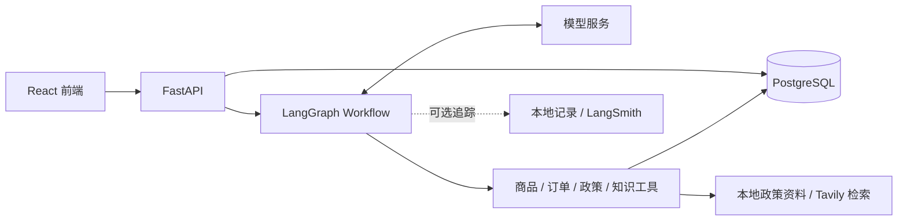

# PC E-commerce Agent

**面向 PC 外设商城的 AI 客服助手，让选购咨询围绕需求与商品事实展开。**

外设选购既有领域知识门槛，又以参数比较为主：键盘的轴体与连接方式、鼠标的重量与 DPI、
显示器的分辨率与刷新率，都需要结合预算和使用场景判断。用户往往从“想买个适合办公的键盘”
开始，在对话中逐步明确条件，而价格、库存、订单和店铺政策又需要查询实际数据。

这让外设电商很适合用 Agent：理解自然语言需求，通过追问与连续对话明确条件，调用工具检索、
筛选商品，再用用户能理解的方式解释选择依据。本项目提供可在本地运行的前后端和 Demo 数据，
用于体验这一完整流程。

[快速开始](#quick-start) · [演示体验](#demo-data) · [追踪](#tracing) · [分支说明](#branches)

> 本分支归档 **LangGraph Workflow** 实现。当前 Agent Loop 版本请使用 `develop`；以下步骤对应归档版本。

## 功能

- **商品选购**：按预算和规格筛选商品，查询型号与版本详情，辅助比较候选。
- **连续咨询**：承接上下文和用户偏好，逐步缩小选购范围。
- **订单与物流**：查询当前登录用户的订单、商品明细和物流进展。
- **政策与知识**：引用店铺政策，检索外设知识，解释参数与使用问题。
- **人工诉求**：记录需要人工处理的请求；不自动办理支付、退款或订单修改。

<a id="architecture"></a>
## 架构概览



<a id="quick-start"></a>
## 快速开始

以下步骤适用于 **macOS / Linux 的首次本地搭建**。准备 uv、Node.js 24（最低 22）、npm、
Podman、Git、Make、curl 和 OpenSSL。Python 3.11 由 uv 管理。安装需联网下载依赖、镜像与模型；
AI 对话需自备模型 API Key，模型与搜索调用可能产生费用。

### 1. 获取代码

```bash
git clone --branch archive/langgraph-workflow https://github.com/Laleylaa/pc-ecommerce-agent.git
cd pc-ecommerce-agent
```

确保 Podman 可用。macOS 使用 `podman machine list` 检查：没有 machine 时执行
`podman machine init`，已有但未运行时执行 `podman machine start`。

<a id="configuration"></a>
### 2. 配置环境

首次创建本地配置：

```bash
cp .env.example .env
openssl rand -hex 32
```

编辑根目录 `.env`：

| 配置 | 填写方式 |
| --- | --- |
| `LLM_API_KEY` | 填入你的模型密钥；模板默认使用官方 DeepSeek |
| `AUTH_TOKEN_SECRET` | 填入上一步生成的随机字符串 |
| `TAVILY_API_KEY` | 外设知识联网搜索所需；留空时该能力不可用，本店政策检索不受影响 |

其他配置见 [.env.example](.env.example)。本分支默认启动 PostgreSQL、Redis 和 Chroma，
端口分别为 `5432`、`6379`、`8001`；后端 `8000`，前端 `5173`。
已有 `.env` 请按模板核对，不要覆盖。真实密钥只保存在本地。

<details>
<summary>端口冲突 / 创建独立环境</summary>

新建独立环境时，初始化前调整 `PODMAN_PROJECT_NAME` 和数据库服务端口，并同步核对
`DATABASE_URL`、`REDIS_URL`、`CHROMA_PORT`。数据库连接地址不会自动从容器凭据派生。
仅切换分支或更换代码目录不会隔离数据；修改 `.env` 也不会修改已有数据库的密码。

后端监听端口通过 `make backend BACKEND_PORT=8002` 设置，不读取根 `.env` 中的同名配置。
同时在 `frontend/.env.local` 设置 `VITE_DEV_PROXY_TARGET=http://127.0.0.1:8002` 并重启前端，
模板见 [frontend/.env.example](frontend/.env.example)。前端端口固定为 5173；更改时需同步调整 Vite 和 CORS。
服务端密钥不能放入 `VITE_*`。

</details>

### 3. 初始化

**此步骤仅用于首次搭建的独立演示数据库**：

```bash
make setup-local
```

该命令依次检查环境、安装依赖、启动基础设施、应用迁移、导入商品与演示账号订单、
同步 Chroma，并准备本地政策检索模型。

归档版本的初始化脚本会更新已有商品、演示账号密码等记录，**不会因数据库非空而拒绝写入**。
已有环境请使用下面的复用流程，不要重复运行初始化。

<details>
<summary>复用已有环境 / 初始化中途失败</summary>

```bash
make install
make config-check
make infra-up
make db-status
make model-prepare
```

迁移版本落后时按需执行 `make db-migrate`，不要重复运行 `make db-init`。
若初始化只在模型下载阶段失败，修复网络后单独重试 `make model-prepare`。

</details>

### 4. 启动

在项目根目录打开两个终端，分别运行：

```bash
make backend
```

```bash
make frontend
```

打开 [http://localhost:5173](http://localhost:5173)。默认健康检查地址为
[http://127.0.0.1:8000/api/health](http://127.0.0.1:8000/api/health)，
`postgres`、`redis`、`chroma` 均为 `ok` 时整体状态为 `ok`。

<a id="demo-data"></a>
## 演示体验

初始化后使用以下账号登录：

| 账号 | 密码 |
| --- | --- |
| `demo@example.com` | `demo-password` |
| `test_user_001@example.com` 至 `test_user_005@example.com` | `isolation-demo-password` |

可以试试：

- “推荐几款 500 元以内的无线机械键盘。”
- “查看我的最近一笔订单和物流。”
- “键盘拆封后还能七天无理由退货吗？”

仓库提供六类外设的合成商品、演示账号与订单，以及政策资料，无需自行收集数据。
商品规格、报价和政策用于演示，账号仅用于本地体验。
`make infra-stop` 停止基础设施并保留数据，之后用 `make infra-up` 再次启动。

<a id="tracing"></a>
## 可选：调用追踪

在 `.env` 设置 `AGENT_TRACE_MODE=local`，重启后端并发起对话。
记录默认保存在本地 `backend/evals/results/agent_traces/`，可查看模型、工具与流程执行信息。

需要 LangSmith 云端追踪时，按 [追踪使用说明](backend/evals/README.md) 配置。
本分支不包含 Phoenix 启动入口。追踪默认关闭，记录可能包含对话内容，上传前需确认分享范围。

## 遇到问题

- **环境或容器不可用**：运行 `make doctor`，确认 Podman 已启动；`make infra-status` 查看服务状态。
- **配置不正确**：安装依赖后运行 `make config-check`，对照 `.env.example` 检查。
- **页面能打开但回答失败**：检查健康接口、后端日志、模型密钥与前端代理地址。

<a id="branches"></a>
## 分支说明

| 分支 | 用途 |
| --- | --- |
| `develop` | 当前 Agent Loop 开发版本，运行方式以该分支 README 为准 |
| `main` | 当前仍为旧版本，尚未同步 Agent Loop 发布内容 |
| `archive/langgraph-workflow` | LangGraph Workflow 归档；本页搭建步骤对应此分支 |

<a id="development"></a>
## 开发

```bash
make check
```

检查包含后端测试、Ruff 和前端构建。隔离测试入口与执行边界见
[测试说明](backend/tests/README.md)，真实模型评测需显式执行，见 [评测说明](backend/evals/README.md)。

<a id="acknowledgements"></a>
## 致谢

项目源自硕士毕业设计团队共同开发的 [Loda951/pc-agnet](https://github.com/Loda951/pc-agnet)，
感谢原团队的共同贡献。本分支保留 LangGraph Workflow 版本及团队项目来源。
