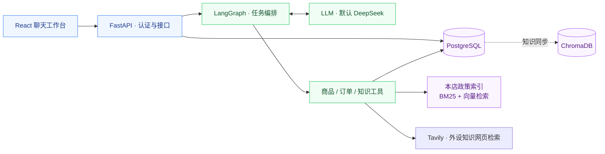

<div align="center">

# PC E-commerce Agent

**面向 PC 外设商城的 AI 客服助手**

从商品选购、规格对比到订单查询与售后咨询，在连续对话中连接用户需求与业务数据。


[功能亮点](#features) · [系统架构](#architecture) · [快速开始](#quick-start) · [配置说明](#configuration)

</div>

---

基于 FastAPI、LangGraph 和 React 构建的全栈客服 Agent。后端将用户请求拆解为任务，通过商品、订单与知识检索工具获取依据，再生成回答；前端提供登录、历史对话、商品展示和人工请求交互。

项目源自硕士毕业设计团队项目，目前用于持续开发与本地演示。团队来源见[致谢](#acknowledgements)。

<a id="features"></a>
## 功能亮点

| 能力 | 可以做什么 | 对话示例 |
| --- | --- | --- |
| **商品选购** | 按预算、类别和规格检索商品，比较候选商品 | “推荐一款 500 元以内的机械键盘” |
| **连续对话** | 承接本轮上下文，管理用户明确表达的长期偏好 | “有没有更便宜的？” |
| **订单查询** | 查询当前登录用户的订单与物流信息 | “查看我的最近一笔订单” |
| **知识问答** | 结合本店政策资料与外设知识网页检索结果回答问题 | “退货需要满足什么条件？” |
| **人工请求** | 记录需要人工确认的售后诉求，查询请求状态 | 在页面提交退货或维修诉求 |
| **用户隔离** | 登录认证，并校验会话、记忆与订单的归属 | 不同用户访问各自的业务数据 |

> [!NOTE]
> 当前支持查询、咨询和人工请求记录。退款、订单修改、支付及真实客服派单尚未接入；提交人工请求不会自动办理这些业务。

<a id="architecture"></a>
## 系统架构



| 层级 | 技术与职责 |
| --- | --- |
| 前端 | React 19 · TypeScript · Vite，提供聊天与业务信息展示 |
| API 与编排 | Python 3.11 · FastAPI · LangGraph，负责认证、任务执行和回答生成 |
| 数据存储 | PostgreSQL · SQLAlchemy · Alembic，保存业务数据、会话与运行记录 |
| 知识检索 | 本店政策：本地 JSON · BM25 + SentenceTransformer；外设知识：Tavily Web Search |
| 本地基础设施 | Podman 管理 PostgreSQL、Redis 和 ChromaDB |
| 依赖管理 | uv 与 npm，分别通过锁文件安装后端和前端依赖 |

政策工具使用本地索引，外设知识工具使用 Tavily；ChromaDB 保留知识同步路径，Redis 当前用于健康检查。页面通过 `/api/chat` 一次性获取完整回答及执行详情。

<a id="quick-start"></a>
## 快速开始

以下步骤适用于 **macOS / Linux 本地开发**。获取代码后进入项目根目录，所有 `make` 命令均在该目录执行。

### 1. 准备环境

| 工具 | 要求 |
| --- | --- |
| [uv](https://docs.astral.sh/uv/getting-started/installation/) | 安装 Python 3.11 与后端依赖，无需额外创建 Conda 环境 |
| [Node.js](https://nodejs.org/en/download) / npm | 推荐 Node 24，最低 Node 22；版本约定位于 `.nvmrc` |
| [Podman](https://podman.io/docs/installation) | macOS 需先启动 Podman machine |
| Make / curl | 执行项目命令与服务就绪检查 |

<details>
<summary>macOS 工具准备与 Podman machine 检查</summary>

已安装 Homebrew 时，可用 `brew install uv` 安装 uv。使用 nvm 时，在项目根目录执行 `nvm install` 和 `nvm use`，选择 `.nvmrc` 中的版本。

```bash
podman machine list
```

仅在没有 machine 时执行 `podman machine init`；已有 machine 未运行时执行 `podman machine start`。

</details>

```bash
make doctor
```

检查工具和 Podman 连接。首次安装需要联网下载依赖、容器镜像，以及缺失的 Python 或 embedding 模型。

### 2. 配置环境变量

根目录尚无 `.env` 时，复制模板：

```bash
cp .env.example .env
```

编辑 `.env`，核对以下配置：

| 配置 | 填写方式 |
| --- | --- |
| `LLM_API_KEY` | 填入自己的模型 API key，默认使用 DeepSeek |
| `TAVILY_API_KEY` | 外设知识网页搜索：在 [Tavily](https://app.tavily.com) 注册后填入 key；留空时明确返回未配置，本店政策检索不受影响 |
| `AUTH_TOKEN_SECRET` | 填入私有随机字符串，用于后端签发和验证登录凭证 |

生成认证密钥：

```bash
openssl rand -hex 32
```

将输出复制到 `AUTH_TOKEN_SECRET`，保留在本机。已有 `.env` 时直接核对配置，不要重新覆盖。前端默认通过 `/api` 代理访问后端，无需另配环境文件。

Tavily 使用 basic 搜索，每次请求最多 10 条，8 秒总超时，不自动重试或请求生成式答案。官方目前提供每月 1,000 免费 credits，无需绑卡，basic 每次 1 credit；以 [官方额度说明](https://docs.tavily.com/documentation/api-credits) 为准。填好 key 后重启后端。key 仅放根目录 `.env`，不要放入 `VITE_*`。

本店政策默认使用 BM25 + 本地向量混合检索，索引缺失或过期时退回 BM25 并标明实际策略。请求内不下载模型；缺少模型时运行已有的 `make model-prepare` 显式准备。政策超时为 8 秒；同步计算移到单个后台线程，超时或取消后运行中的计算仍占用名额直到完成，期间新请求返回忙碌状态。

商品搜索、目录和订单的自然语言规划增加语义复核：程序校验后由模型对照原请求检查，再经程序校验才执行。规划与复核共用 60 秒预算、最多两次纠错和一次传输重试，正常两次模型调用；复核使用成对示例及程序派生的条件匹配解释。外层工具超时均为 75 秒。无法确认或耗尽预算返回失败，不作为“没有商品/订单”。明确编号等确定性路径仍按原规则执行。离线检查和真实模型对照入口见 [评测说明](backend/evals/README.md#正常购物工具评测)。

> [!IMPORTANT]
> 真实 `.env`、API key 和数据库备份不提交到 Git。模型 key 留空时只有有限 fallback，无法验证完整 AI 对话能力。

### 3. 初始化数据与依赖

**首次创建本地演示环境：**

```bash
make setup-local
```

依次完成工具检查、前后端依赖安装、配置校验、基础设施启动、数据库迁移、演示数据导入、Chroma 同步和本地检索模型准备。初始化完成后，继续下一步启动前后端。

| 演示内容 | 默认规模 |
| --- | --- |
| 商品 | 6 类外设 · 192 个 SPU · 2,304 个 SKU |
| 用户与订单 | 6 个演示用户 · 26 笔订单 |
| 知识检索 | 仓库内置知识 JSON 与向量索引 |

这些是脚本生成或仓库内置的演示数据；拉取代码不会带上其他开发者数据库中的聊天记录和业务变更。

> [!WARNING]
> `make setup-local` 会向配置指向的数据库写入数据。**已有本地数据库时，使用下面的复用流程**，不必重复初始化。

<details>
<summary><strong>复用已有数据库：安装依赖并检查现有环境</strong></summary>

```bash
make install
make config-check
make infra-up
make db-status
make model-prepare
```

`db-status` 显示已应用迁移与可用 head；版本一致且已有演示数据时，可直接启动。版本落后时按需执行 `make db-migrate`。

默认 `PODMAN_PROJECT_NAME=pc-agent`，会复用同名容器和数据卷。仅移动或重命名代码目录不会隔离数据库。需要独立环境时，见[配置说明](#configuration)。

</details>

### 4. 启动并体验

打开两个终端，均进入项目根目录：

**终端 A · 后端**

```bash
make backend
```

**终端 B · 前端**

```bash
make frontend
```

| 入口 | 地址 |
| --- | --- |
| **应用页面** | [localhost:5173](http://localhost:5173) |
| API 文档 | [127.0.0.1:8000/docs](http://127.0.0.1:8000/docs) |
| 服务健康检查 | [127.0.0.1:8000/api/health](http://127.0.0.1:8000/api/health) |

使用已初始化的演示账号登录：

| 账号 | 密码 |
| --- | --- |
| `demo@example.com` | `demo-password` |
| `test_user_001@example.com` ～ `test_user_005@example.com` | `isolation-demo-password` |

检查健康接口中的 `postgres`、`redis`、`chroma` 均为 `ok`，再依次体验登录、商品推荐、追问、本人订单查询和政策问答。

## 日常开发

完成首次安装后，每次启动只需：

```bash
make infra-up     # 启动基础设施
make backend      # 终端 A：后端
```

```bash
make frontend     # 终端 B：前端
```

前后端分别按 **Ctrl+C** 停止；`make infra-stop` 停止基础设施，保留容器与数据卷。

<details>
<summary>常用命令速查</summary>

| 命令 | 用途 | 数据影响 |
| --- | --- | --- |
| `make help` / `make doctor` / `make infra-status` | 帮助、环境检查与容器状态 | 只读 |
| `make install` | 安装锁定的前后端依赖 | 不写数据库 |
| `make config-check` | 检查配置结构与认证密钥占位值 | 不验证凭据真伪或连通性 |
| `make db-status` | 查看数据库迁移版本 | 只读 |
| `make db-migrate` | 应用新增迁移 | 修改数据库结构 |
| `make db-init` | 迁移、商品导入、演示数据与知识同步 | 写入数据 |
| `make model-prepare` | 下载或预热模型，校验本地索引 | 不重建业务数据 |
| `make knowledge-index` | 重建本地知识向量索引 | 修改本地索引文件 |
| `make knowledge-sync` | 将 PostgreSQL 知识表同步到 Chroma | 写入 Chroma |
| `make check` | 后端测试与 Lint、前端构建 | 当前不含真实数据库测试；默认排除外部网络用例 |

查看日志：`./scripts/podman-infra.sh logs postgres`，服务名也可替换为 `redis` 或 `chroma`。

`down` 移除容器但保留卷；`reset` 删除容器及数据卷，需要显式设置 `CONFIRM_RESET=1`。两者均不属于日常启动步骤。

</details>

<a id="configuration"></a>
## 配置说明

后端与 Podman 脚本读取根目录 [`.env.example`](.env.example) 对应的 `.env`；前端可选配置见 [`frontend/.env.example`](frontend/.env.example)。后端按源码位置定位配置，不依赖终端所在目录。

<details>
<summary>模型、数据库与基础设施配置</summary>

| 配置 | 说明 |
| --- | --- |
| `LLM_PROVIDER` / `LLM_MODEL` / `LLM_BASE_URL` | 默认 DeepSeek；base URL 留空时按 provider 选择 |
| `POSTGRES_DB` / `POSTGRES_USER` / `POSTGRES_PASSWORD` | 创建 PostgreSQL 容器时使用的数据库凭据 |
| `DATABASE_URL` | 后端数据库连接，须与用户、密码及主机端口一致 |
| `REDIS_URL` / `CHROMA_HOST` / `CHROMA_PORT` | 后端连接 Redis 与 Chroma 的地址 |
| `PODMAN_PROJECT_NAME` | 容器和数据卷命名前缀，默认 `pc-agent` |
| `POSTGRES_PORT` / `REDIS_PORT` / `CHROMA_PORT` | 默认主机端口：5432 / 6379 / 8001 |
| `POSTGRES_IMAGE` / `REDIS_IMAGE` / `CHROMA_IMAGE` | 镜像选择；Chroma 在模板中固定为不可变摘要 |
| `BACKEND_CORS_ORIGINS` | 默认允许 localhost / 127.0.0.1 的 5173 端口 |

Podman 设置优先使用非空 shell 环境变量，未设置时读取 `.env` 或默认值。环境文件使用简单 `KEY=value` 或整段引号值，不使用 shell 表达式、变量插值或行尾注释；数据库 URL 中的特殊字符需 URL 编码。

</details>

<details>
<summary>前端代理与自定义端口</summary>

前端需要覆盖默认配置时，复制 `frontend/.env.example` 为 `frontend/.env.local`：

- `VITE_DEV_PROXY_TARGET`：开发代理目标，默认 `http://127.0.0.1:8000`。
- `VITE_API_BASE_URL`：浏览器直连 API 的地址；默认留空，使用代理。

例如将后端改为 8002 端口：

```bash
make backend BACKEND_PORT=8002
```

同时将前端 `VITE_DEV_PROXY_TARGET` 改为 `http://127.0.0.1:8002` 并重启前端。`BACKEND_HOST` 和 `BACKEND_PORT` 是 Make 参数，不从根目录 `.env` 读取。

前端固定使用 5173，端口被占用时会报错，不自动换端口。修改前端端口时同步调整 Vite 配置和 CORS。前端不读取根目录 `.env`，`VITE_*` 中不放服务端密钥。

</details>

<details>
<summary>创建独立数据库，避免与其他本地副本共享数据</summary>

初始化前修改 `PODMAN_PROJECT_NAME`，并选择未占用的主机端口，例如 PostgreSQL 15432、Redis 16379、Chroma 18001；同步调整 `DATABASE_URL`、`REDIS_URL` 和 `CHROMA_PORT`。

只更换前缀不能解决端口冲突。已有容器不会自动重建，修改 `.env` 也不会修改已有数据库用户的密码。端口不一致时脚本会停止并提示。

</details>

## 项目结构

```text
.
├── backend/
│   ├── app/
│   │   ├── agent/          # LangGraph 编排、任务与上下文
│   │   ├── api/            # FastAPI 路由
│   │   ├── tools/          # 业务工具契约与实现
│   │   ├── services/       # 认证、记忆与知识服务
│   │   ├── repositories/   # 数据访问
│   │   └── models/         # 数据模型
│   ├── alembic/            # 数据库迁移
│   ├── data/               # 运行所需的知识与向量索引
│   ├── scripts/            # 初始化、导入与评测脚本
│   ├── tests/              # 后端测试
│   └── uv.lock             # 后端依赖锁文件
├── frontend/
│   ├── src/                # 页面、组件与 API 封装
│   └── package-lock.json   # 前端依赖锁文件
├── scripts/                # 环境检查与 Podman 管理
├── .env.example            # 后端与基础设施配置模板
└── Makefile                # 安装、启动与检查的统一入口
```

## 测试与维护

Agent 调试与技术评测 trace 使用 LangChain/LangSmith，并同步写入本地统一目录
`backend/evals/results/agent_traces/`（默认忽略）。默认关闭普通聊天记录；离线冒烟、真实模型
评测、上传配置及产物字段见 [Agent trace 使用说明](backend/evals/README.md)。
离线检查不需要数据库或模型密钥：在 `backend/` 执行
`.venv/bin/python -m scripts.eval_goal_tool_flow --scripted`。

```bash
make check
```

运行后端 pytest、Ruff 和前端 TypeScript / Vite 构建。当前 pytest 集合不含真实数据库集成测试，默认排除 network 标记测试；数据库读写与持久化隔离不在这套自动化测试的验证范围内。模块、冒烟和依赖选择见 [后端测试入口](backend/tests/README.md)。页面交互与真实模型效果需另做验证，完整从零复现还需使用独立新数据库执行初始化。

- **依赖更新**：后端修改 `pyproject.toml` 后在 `backend/` 执行 `uv lock`；前端通过 npm 更新并提交锁文件。普通安装保持锁定版本。
- **知识更新**：修改 `backend/data/knowledge_documents.json` 后执行 `make knowledge-index` 并重启后端；`make knowledge-sync` 不会更新本地 JSON 索引。
- **评测输入**：仓库不包含根目录客服 CSV 评测数据集，对应评测需自行提供输入，不影响应用启动。

代码约定见 [AGENTS.md](AGENTS.md)。

## 常见问题

<details>
<summary>系统 Python 版本不对，或提示找不到 uv</summary>

先安装 uv 并重新打开终端，再运行 `make doctor` 和 `make backend-install`。uv 按项目约定选择 Python 3.11，后端启动自动使用 `backend/.venv`。

</details>

<details>
<summary>Podman 无法连接，或容器启动失败</summary>

macOS 先检查 `podman machine list`，启动已有 machine。使用 `make infra-status` 查看容器，使用 `./scripts/podman-infra.sh logs chroma` 等命令查看日志，再核对端口、镜像与数据卷兼容性。

</details>

<details>
<summary>配置检查提示 AUTH_TOKEN_SECRET 无效</summary>

执行 `openssl rand -hex 32`，将结果填入本地 `.env`，替换占位值。它是后端的登录凭证签名密钥，不是用户密码或模型 API key。

</details>

<details>
<summary>页面能打开，但请求失败或 AI 回答不完整</summary>

先检查后端终端日志和 `/api/health`，确认后端正在运行、代理指向正确地址；直连模式还需核对 CORS。完整 AI 对话需要有效模型 key。首次知识问答慢或下载失败时，运行 `make model-prepare` 检查模型准备情况。

</details>

<details>
<summary>依赖锁文件不一致，安装失败</summary>

核对依赖声明与锁文件是否配套；维护者更新声明后应重新生成锁文件并验证。不要通过删除锁文件绕过检查。

</details>

<a id="acknowledgements"></a>
## 致谢

本项目基于硕士毕业设计团队共同开发的 [Loda951/pc-agnet](https://github.com/Loda951/pc-agnet) 持续维护，保留原团队贡献与项目来源。当前版本在此基础上完善运行环境与依赖管理，并继续完善功能和设计。
