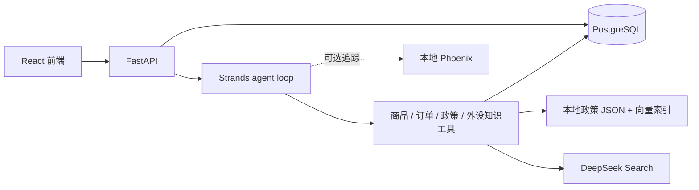

# PC E-commerce Agent

面向 PC 外设商城的 AI 客服助手，使用 **FastAPI + Strands agent loop + React**。
支持商品推荐与规格查询、本人订单和物流查询、政策引用、连续对话与人工诉求记录。

当前 `develop` 为完整开发线（原 `refactor/agent-loop`）；`archive/langgraph-workflow`
保留旧 LangGraph workflow。`main` 的发布材料尚未整理，本页对应当前 develop。

项目源自硕士毕业设计团队项目 [Loda951/pc-agnet](https://github.com/Loda951/pc-agnet)，
保留原团队贡献与来源。当前提供咨询、查询和人工诉求记录，不自动办理支付、退款或订单修改。

[快速开始](#quick-start) · [配置](#configuration) · [Demo 数据](#demo-data) ·
[Phoenix](#local-phoenix-trace) · [开发验证](#development)

<a id="architecture"></a>
## 运行结构



PostgreSQL 是必需的持久化服务。政策检索使用仓库内置 JSON、BM25 和本地向量索引；
Redis 与 Chroma 是保留的可选组件，默认不启动、不参与健康检查。
前端通过 `/api` 代理访问后端，聊天接口为 `/api/chat`。

<a id="quick-start"></a>
## 从零启动

以下流程面向 macOS / Linux 本地演示，需联网下载依赖、镜像和 embedding 模型。
完整 AI 对话需要有效模型 API key；模型与搜索服务可能产生费用。
首次使用应创建新的空数据库，不能对已有业务库重复初始化。

### 1. 获取代码与准备工具

首次获取使用 clone；已有检出才使用 pull：

```bash
git clone --branch develop https://github.com/Laleylaa/pc-ecommerce-agent.git
cd pc-ecommerce-agent
```

| 工具 | 约定 |
| --- | --- |
| uv | 管理 Python 3.11 和后端依赖，锁文件为 `backend/uv.lock` |
| Node.js / npm | 推荐 Node 24，最低 22；版本见 `.nvmrc` |
| Podman | 管理本地 PostgreSQL 和可选观测平台 |
| Make / curl | 执行安装命令与就绪检查 |

macOS 可使用 Homebrew 安装 uv、Node 和 Podman。已使用 nvm 时执行 `nvm install && nvm use`。
macOS 上先执行 `podman machine list`，已有 machine 使用 `podman machine start`；
仅在没有 machine 时才执行 `podman machine init`。Linux 按本机 Podman 安装方式启动。

```bash
make doctor
```

此命令只检查工具与 Podman，不创建数据库或导入数据。

### 2. 填写配置

根目录没有 `.env` 时复制：

```bash
cp .env.example .env
openssl rand -hex 32
```

在 `.env` 中填写自己的 `LLM_API_KEY`，将随机字符串填入 `AUTH_TOKEN_SECRET`。
默认使用官方 DeepSeek；其他提供方还需核对模型名、API 地址和兼容能力。
使用非官方 DeepSeek 模型配置时，外设知识联网查询需单独设置 `DEEPSEEK_SEARCH_API_KEY`。

本地默认端口：PostgreSQL 5432、后端 8000、前端 5173。端口被占用时先在 `.env` 调整，
不要为了启动新副本停止或重置其他项目的数据卷。详细规则见[配置](#configuration)。

### 3. 安装与初始化

推荐第一次逐步执行，以便定位失败步骤：

```bash
make install          # 后端运行依赖 + 前端依赖，不安装后端测试工具
make config-check     # 校验配置结构，不调用模型或连接数据库
make infra-up         # 默认仅创建/启动 PostgreSQL
make demo-info        # 只读查看演示数据清单
make db-init          # 应用迁移，再向空库导入全部 Demo 数据
make model-prepare    # 下载/预热政策检索使用的 embedding 模型
```

上述首次安装步骤也可由 `make setup-local` 顺序执行。
新 Demo 导入会检查所有应用表；发现已有数据就停止，不重置密码、不覆盖订单、不自动清库。
整批 Demo 写入在一个事务内完成。初始化期间不要同时启动后端或运行其他写入程序。

如果数据库已初始化，只需准备依赖、启动服务并检查迁移状态：

```bash
make install
make config-check
make infra-up
make db-status
make model-prepare
```

版本落后时按需执行 `make db-migrate`，不要重复 `db-init`。
若 `setup-local` 在模型下载阶段失败，数据库可能已经初始化成功；解决下载问题后单独重试
`make model-prepare`，不要从头重复初始化。

### 4. 启动前后端

分别在两个终端、项目根目录运行：

```bash
make backend
```

```bash
make frontend
```

默认打开 `http://localhost:5173`。健康检查：

```bash
curl http://127.0.0.1:8000/api/health
```

默认应看到 `status: ok`、`postgres: ok`、`redis: disabled`、`chroma: disabled`。
配置检查只代表结构合法；健康检查也不代表模型 key 或完整业务链路已经验证。

### 5. 登录并体验

新 Demo 数据中的公开演示账号：

| 账号 | 密码 | 可体验内容 |
| --- | --- | --- |
| `demo@example.com` | `demo-password` | 商品、政策以及一笔已发货订单 |
| `demo2@example.com` 至 `demo6@example.com` | `demo-password` | 每人五种状态的订单与用户归属隔离 |

建议依次输入：

- 推荐几款 500 元以内的无线机械键盘。
- 查看我的最近一笔订单和物流。
- 键盘拆封后还能七天无理由退货吗？

已有开发数据库仍使用原有账号和数据，新 Demo 不会自动改写它。
这些公开密码仅用于本机演示；认证签名密钥仍由每位部署者自行生成。

<a id="configuration"></a>
## 配置与日常运行

配置定义集中在 [Settings](backend/app/core/config.py)，模板为 [.env.example](.env.example)。
应用和 Podman 读取同一份根 `.env`，优先级为：显式程序参数 → 进程环境变量 → `.env` → 默认值。
`.env` 使用 dotenv 语法，绝不作为 shell 脚本执行。不要提交真实凭据。

| 分组 | 主要字段与行为 |
| --- | --- |
| 模型 | `LLM_PROVIDER/MODEL/API_KEY/BASE_URL`，`DEEPSEEK_SEARCH_API_KEY` |
| 数据库 | `POSTGRES_HOST/PORT/DB/USER/PASSWORD`；空 `DATABASE_URL` 从它们派生并编码特殊字符 |
| 完整数据库地址 | 非空 `DATABASE_URL` 优先于派生值；用于已有/外部数据库时自行保证指向正确目标 |
| 容器隔离 | `PODMAN_PROJECT_NAME` 派生网络、容器和卷名；可显式覆盖单项名称 |
| 访问端口 | `BACKEND_HOST/PORT`、`FRONTEND_PORT`；`make backend/frontend` 统一读取 |
| CORS | 空 `BACKEND_CORS_ORIGINS` 从前端端口派生本机来源；可显式指定逗号列表或 JSON 列表 |
| Phoenix | `LOOP_TRACE_ENABLED`；平台固定在本机 `127.0.0.1:6006` |
| 可选服务 | `REDIS_ENABLED`、`CHROMA_ENABLED`，默认 false |
| 开发兼容 | `AGENT_RUNTIME=strands`，保留 `legacy` 显式切换；旧追踪与 Phoenix 分开 |

更改 PostgreSQL 密码不会修改已有数据卷中的数据库密码。更改容器映射端口也不会自动重建
已有容器；脚本发现端口不一致会拒绝复用。使用外部数据库时可跳过本地 `infra-up`，
直接核对连接并运行迁移和空库导入。

前端默认无需另配 `.env`。需要代理外部后端时，在 `frontend/.env.local` 设置
`VITE_DEV_PROXY_TARGET`；浏览器 API 基址覆盖沿用 `VITE_API_BASE_URL`。
任何模型、数据库或认证秘密都不能放入 `VITE_*`。直接 `npm run dev` 使用前端自己的默认值，
统一根配置请使用 `make frontend`。命令行 `make backend BACKEND_PORT=8002` 只影响该进程；
若要前后端一起切换端口，修改根 `.env`。

```bash
make infra-stop       # 停止商城基础设施，保留数据
make infra-up         # 按配置启动，复用已有卷
make infra-status
make db-status
```

修改端口/前缀可以建立独立副本；仅切 Git 分支或改代码目录名不会隔离数据库。
Redis/Chroma 如需使用，启用相应配置后再 `make infra-up`。
`make knowledge-sync` 仅在显式启用 Chroma 时可用，将数据库知识同步到它；不是聊天政策检索的前置步骤。

<a id="demo-data"></a>
## Demo 数据与本地持久化

数据来源、账号和维护边界见 [Demo 说明](backend/data/demo/README.md)，
版本与规模见 [manifest](backend/data/demo/manifest.json)。商品生成规则和导入逻辑集中在
`backend/scripts/demo/`；不需要先收集数据，也不需要下载旧 pc-part-dataset。

- 商品：6 类、192 个 SPU、2,304 个 SKU，合成价格/库存/规格，不代表真实商品报价。
- 账号与订单：6 个账号、26 笔订单；不预置测试会话、偏好或开发 trace。
- 政策：`backend/data/knowledge_documents.json` 是正文来源；数据库导入和检索读取同一份资料。
- 向量索引：内置 `knowledge_vector_index.json`，模型为 `BAAI/bge-small-zh-v1.5`；
  修改正文后通过 `make knowledge-index` 重建，保留正文哈希一致性检查。
- 导入时间：订单与物流基于初始化时同一个 UTC 时刻生成；订单号只是标识，不表示订单日期。

运行数据由 Podman 卷保存：默认 `pc-agent-postgres-data`；可选服务使用
`pc-agent-redis-data` 和 `pc-agent-chroma-data`。Phoenix 使用独立卷。
Git 保存源码、Demo 来源、迁移和必要输入；develop 还保存测试驱动与固定用例。
开发 issues、迭代记录和批次成绩统一留在忽略的 docs/artifacts；数据库、`.env`、聊天和 trace 不随推送备份。
导出资料放入忽略的 `backups/` 或 `artifacts/`，需要另做私有异机备份。

<a id="local-phoenix-trace"></a>
## 可选：Phoenix 观测

```bash
make trace-up
make trace-status
```

在 `.env` 设置 `LOOP_TRACE_ENABLED=true`，重启后端并发起一次聊天。
访问 `http://127.0.0.1:6006`，进入 `pc-ecommerce-agent-local` 项目，按请求时间或后端日志中的
`trace_id` 查看用户请求、模型输入输出、工具结果、程序校验、错误、耗时与 Token 用量。
拒绝的查询计划和复核结果会留在对应节点中；模型提出调用不等于执行成功。

平台容器为 `pc-ecommerce-agent-phoenix`，独立卷为 `pc-ecommerce-agent-phoenix-data`，
SQLite 数据在容器 `/data/phoenix.db`。镜像锁定为 `docker.io/arizephoenix/phoenix:version-20.23.0`。
平台仅绑定回环地址；`make trace-stop` 保留数据。没有启用追踪的请求不会事后补录。
追踪失败不应阻断业务；输入输出存在大小上限，界面会标明截断，不保证无限保存完整内容。

Phoenix 数据可能包含对话及业务材料，不发布现有数据卷。开发线的 `make trace-demo`
用于合成演示，依赖 tests，未来 main 不包含这个命令。

<a id="development"></a>
## 开发与验证

运行入口是根 Makefile；`Makefile.development` 由 develop 自动包含，集中测试、评测和旧维护入口。

```bash
make dev-install      # 安装额外的后端测试/lint 工具
make help-dev
make check            # 当前离线测试、Ruff 和前端构建
```

`make install` 使用运行依赖同步，可能移除先前安装的测试 extra；需要检查时再运行 `make dev-install`。
默认检查通过 `tests/run.py` 阻断真实网络、数据库与凭据读取。legacy、integration 和收费模型评测
均为显式入口，不属于 `make check`。构建通过不代表浏览器或真实模型端到端验收。

`make data-import`、`make db-seed`、`make legacy-data-import` 是保留的旧维护命令，可能更新既有记录，
不参与新的首次安装流程。测试专用账号/会话仍由 `seed_user_isolation.py` 显式维护。

目录边界：`backend/app/` 为运行代码，`backend/alembic/` 为迁移，`backend/scripts/` 为维护入口，
`frontend/` 为用户界面；`tests/`、`evals/` 只属于开发线。旧 workflow 可通过
`make backend RUNTIME=legacy` 显式使用；归档分支保留完整历史版本。

## 常见问题

- **Podman 不可用**：macOS 检查 `podman machine list/start`，不要重新初始化已有 machine。
- **初始化提示数据库非空**：沿用已有数据，或配置独立数据库；不要运行 reset 来绕过检查。
- **模型或索引准备失败**：检查网络后重试 `make model-prepare`；请求内不会自动下载模型。
  缺失/过期索引会退回 BM25，并不代表混合检索已准备好。
- **页面可打开但回答失败**：先查 `/api/health`、后端日志、模型 key 和服务连通性；
  设置 Phoenix 后复现请求。配置检查不验证真实 key。
- **已有 `.env` 配置较旧**：与新模板逐项对照，保留自己的密钥和数据库地址；不要覆盖真实文件。
  Redis/Chroma 现为显式启用，禁用可选服务不会自动删除既有容器。
- **依赖锁不匹配**：核对声明和锁文件是否来自同一版本，不通过删除锁文件绕过检查。

<a id="acknowledgements"></a>
## 致谢

感谢原硕士团队项目 [Loda951/pc-agnet](https://github.com/Loda951/pc-agnet) 的共同开发与贡献。
当前版本在此基础上持续完善 agent loop、工具、运行环境和用户界面。
